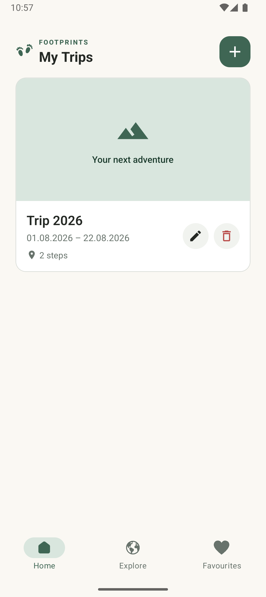
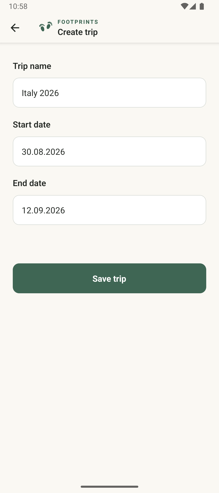
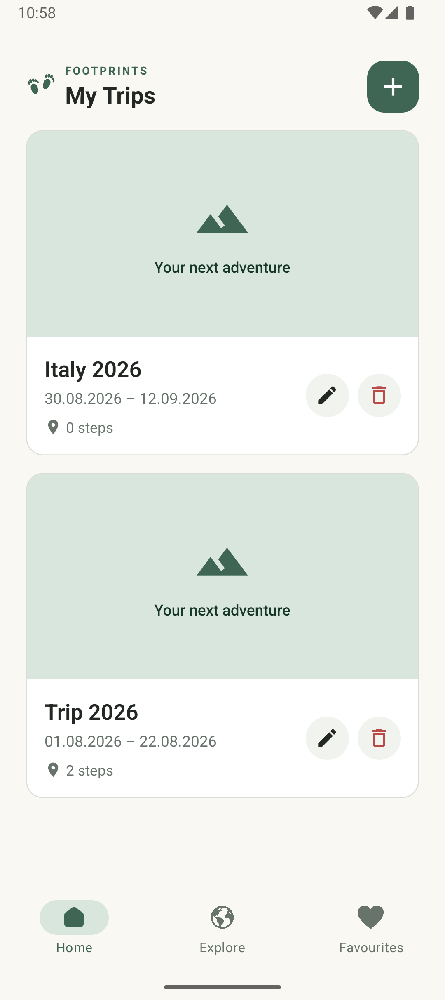
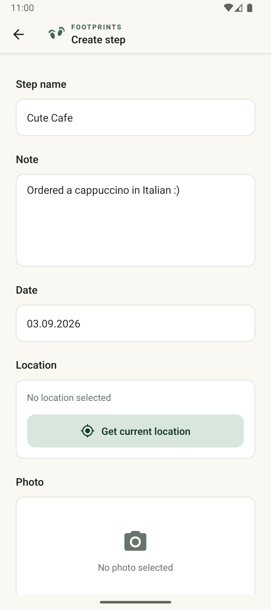
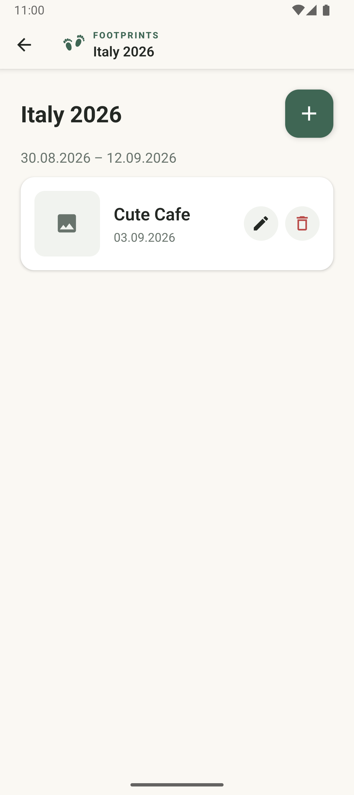
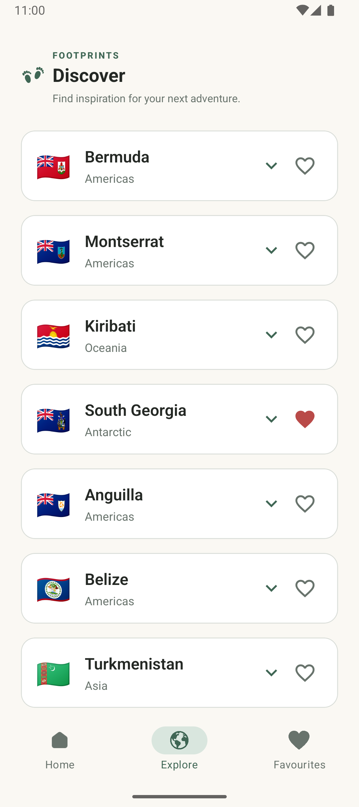
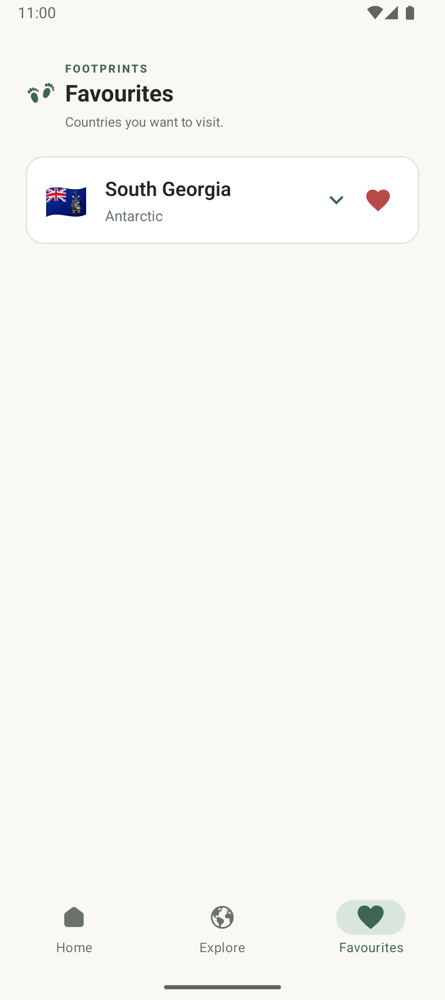

# Footprints

Footprints is a mobile travel diary for documenting trips and their individual stops, called steps. Users can save photos, notes, dates and locations, discover
countries and keep a list of favourite destinations.

## Team

- **Student 1**: Elisabeth Stagl (@elisabethstagl)
- **Student 2**: Valeriia Sineva (@vs1603)
- **App Name**: Footprints

## Features

- Create, edit and delete trips with a name and date range.
- Create, edit and delete steps within a trip.
- Attach an optional note, camera photo and current location to a step.
- Adjust trip dates when a step falls outside the trip's date range.
- Discover ten recommended countries per day.
- Use "Discover more" to save a different selection for the current day.
- Add countries to favourites and remove them again.
- Use saved content offline.
- Follow the system's light or dark theme.

## Technology

| Area                   | Technology                                        |
| ---------------------- | ------------------------------------------------- |
| Framework              | React Native with Expo SDK 58                     |
| Language               | TypeScript                                        |
| Navigation             | Expo Router with native tabs and stack navigation |
| Shared state           | Zustand                                           |
| Local database         | Expo SQLite                                       |
| Photos and files       | Expo Image Picker, Expo Image and Expo FileSystem |
| Location               | Expo Location                                     |
| Connectivity           | Expo Network                                      |
| External data          | REST Countries API                                |
| Testing                | Jest, jest-expo and React Native Testing Library  |
| Code quality           | ESLint with eslint-config-expo                    |
| Continuous integration | GitHub Actions                                    |

## Installation and setup

### 1. Android Emulator (Windows / Mac / Linux)

1. Install **Android Studio**.
2. Open Android Studio $\rightarrow$ **Virtual Device Manager** (AVD) and create a virtual device (e.g., Pixel 6 with API 34).
3. Ensure your `ANDROID_HOME` environment variable is set:
   - **Windows**: Set `ANDROID_HOME` to `C:\Users\<Your-Username>\AppData\Local\Android\Sdk` and add `%ANDROID_HOME%\platform-tools` and `%ANDROID_HOME%\emulator` to your `PATH`.
   - **Mac**: Add `export ANDROID_HOME=$HOME/Library/Android/sdk` and `export PATH=$PATH:$ANDROID_HOME/emulator:$ANDROID_HOME/platform-tools` to your `~/.zshrc`.

#### Managing Emulators via Terminal:

- **List installed emulators**:
  ```bash
  emulator -list-avds
  ```
- **Start an emulator from command line**:
  ```bash
  emulator -avd <YOUR_AVD_NAME>
  ```
  _(Example: `emulator -avd Pixel_6_API_34`)_

### 2. iOS Simulator (Mac Only)

1. Install **Xcode** from the Mac App Store.
2. Open Xcode once to accept the license agreement and install required component tools.
3. Open Simulator via Xcode $\rightarrow$ Open Developer Tool $\rightarrow$ Simulator.

## How to Run the App

### 1. Install dependencies

Clone this repository and open a terminal in its root directory.

```bash
cd footprints
npm install
```

### 2. Configure the API key

Get your REST Countries API key here: https://restcountries.com/sign-up.

Create a `.env` file inside `footprints`:

```env
EXPO_PUBLIC_REST_COUNTRIES_API_KEY=your_api_key_here
```

### 3. Launch on target platform:

- **Android Emulator**:
  - Start your AVD (via Android Studio or `emulator -avd <NAME>`), then run:

  ```bash
  npm run android
  ```

- **iOS Simulator** (Mac only):

  ```bash
  npm run ios
  ```

- **Physical Device (Expo Go Fallback)**:
  - Scan the QR code using the **Expo Go** app:
  ```bash
  npm start
  ```

## Troubleshooting

- **Error: `adb command not found` / `Android SDK path not found`**
  - **Fix**: Ensure `ANDROID_HOME` and the `platform-tools` + `emulator` folders are correctly added to your system `PATH` environment variable.
- **Port 8081 is in use**
  - **Fix**: Type `y` when prompted to switch to port 8082, or kill existing Node processes.

## Tests

The test suite includes tests for date utilities, sorting, trip date extension, API response handling, store behaviour, daily recommendations and UI components.
Network requests and database functions are mocked in the relevant unit tests.

Run all automated tests:

```bash
npm test -- --runInBand
```

Run tests in watch mode:

```bash
npm run test:watch
```

Generate a coverage report:

```bash
npm run test:coverage -- --runInBand
```

### Code quality

Run ESLint to check application code and tests:

```bash
npm run lint
```

The GitHub Actions workflow installs dependencies and runs ESLint and automated tests on every push and pull request.

## Navigation

The main areas are available through three tabs:

- Home: saved trips
- Discover: country recommendations
- Favourites: saved destinations

Trip and step details, creation and editing forms use stack navigation.

## Permissions

The app requests camera permission when taking a photo and foreground location permission when capturing the current location.

Trips, steps and country data are stored in SQLite. Photos are copied into the app's own document directory.

Native permissions are configured through `app.json` and Expo modules.

## Offline behaviour

Trips, steps, notes, saved photos and favourites are stored locally and remain available without an internet connection.

The country catalogue is cached after the first successful API download. Daily recommendations are selected from this local catalogue.

The ten selected country codes and their selection date are stored in SQLite. The selection remains unchanged on the same day, including after restarting the app.

When Discover is opened or the app returns to the foreground on a new day, a new selection is saved. This also works offline.

"Discover more" replaces the saved selection for the current day.

An internet connection is required to download countries when no local catalogue is available.

Location capture depends on device services and reception. Resolving coordinates to a place name may be unavailable offline; the app can display coordinates instead.

## Project structure

```text
CROSS_App/
├── README.md
├── .github/
│   └── workflows/
│       └── ci.yml
├── documentation/
│   ├── project-requirements.pdf
│   ├── project-specification.pdf
│   └── screenshots/
└── footprints/
    ├── app.json
    ├── package.json
    ├── eslint.config.js
    ├── jest.config.js
    ├── tests/
    └── src/
        ├── app/
        ├── components/
        ├── constants/
        ├── hooks/
        ├── services/
        │   └── database/
        ├── store/
        ├── types/
        └── utils/
```

## User journeys

### 1. Create and open a trip

Create a trip → enter its name and travel dates → save it → open the trip from the home screen.





### 2. Add and view a step

Open a trip → add a step → enter its name and date → optionally add a photo, location, and note → save it → view the step details.





### 3. Discover and save destinations

Open Discover → browse recommended destinations → mark a destination as a favourite → open Favourites to view saved destinations.



